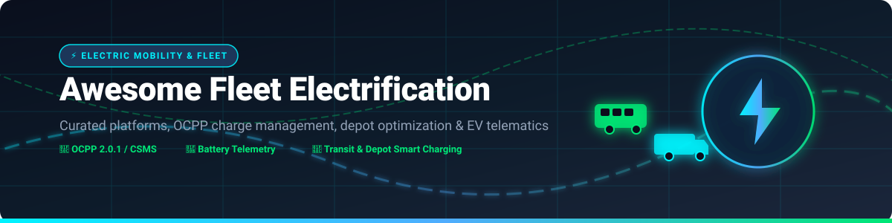

  

# ⚡ Awesome Fleet Electrification 🚚🔋

> **A comprehensive, curated directory of open-source software, commercial SaaS platforms, OCPP charge point management systems (CSMS), depot smart charging optimizers, and EV telematics tools for electric vehicle fleet management.**

---

## 📑 Table of Contents
- [🎯 Overview & Key Features](#-overview--key-features)
- [🏢 Commercial SaaS & Enterprise Hosted Platforms](#-commercial-saas--enterprise-hosted-platforms)
- [⚡ Open-Source Software & Core Frameworks](#-open-source-software--core-frameworks)
  - [🔌 Charging Management & OCPP CSMS](#-charging-management--ocpp-csms)
  - [🛠️ Embedded Charger Firmware & OCPP Stacks](#️-embedded-charger-firmware--ocpp-stacks)
  - [🗺️ EV Route Planning, Logistics & Range Optimization](#️-ev-route-planning-logistics--range-optimization)
- [💡 Quick Start & Selection Guide](#-quick-start--selection-guide)
- [🤝 Contributing](#-contributing)
- [📊 Star History](#-star-history)

---

## 🎯 Overview & Key Features

As logistics, municipal transit, and commercial fleets transition to zero-emission vehicles (ZEVs), software infrastructure plays a critical role in managing charging schedules, monitoring battery State of Charge (SoC) / State of Health (SoH), and avoiding utility peak demand charges.

This directory categorizes both **community-driven open-source software** and **commercial fleet electrification platforms**, covering:
* 🔌 **Charge Point Management Systems (CSMS)** — OCPP 1.6J / 2.0.1 compliant backends for charger monitoring and billing.
* 🔋 **EV Telematics & Battery Analytics** — Ingestion pipelines for vehicle SoC, battery temperature, and range forecasting.
* 🚌 **Depot Smart Charging & Grid Load Balancing** — Peak shaving, tariff optimization, and V2G (Vehicle-to-Grid) integration.
* 📍 **Electric Vehicle Route Planning** — Energy consumption modeling based on elevation, payload, weather, and charging stops.

---

## 🏢 Commercial SaaS & Enterprise Hosted Platforms

*Commercial platforms are sorted below by **Company Scale (Valuation / Market Capitalization / Annual Revenue)** in descending order.*

| 🏢 Platform | 📝 Description | 🎯 Key Focus | 📊 Company Scale (Valuation / Market Cap / Revenue) | 💰 Pricing | 🎁 Free Tier / Trial Limits |
|:---|:---|:---|:---|:---|:---|
| **[Hitachi ZeroCarbon](https://www.hitachi.com/)** | Fleet electrification and charging optimization solutions (ZeroCarbon Charge) focused on live vehicle monitoring, load balancing, and tariff optimization. | Charging optimization & fleet monitoring | **~$159.6 Billion** Market Cap (Conglomerate) | Custom managed service & project-based pricing with co-invested financing options | Free HGV Carbon & Cost Calculator tool + bespoke pilot programs |
| **[Samsara](https://www.samsara.com/)** | Connected operations platform with dedicated fleet electrification tools for EV suitability analysis, charge control, mixed-fleet management, and energy monitoring. | End-to-end fleet electrification + telematics | **~$22.6 Billion** Market Cap (~$1.73B Rev) | ~$27 to $33/vehicle/month (Base tracking; Dashcams: $40–$60+/veh/mo; Upfront hardware: $99–$548/veh) | 30-day risk-free hardware trial (requires sales contact & 3-vehicle minimum) |
| **[Geotab](https://www.geotab.com/)** | Leading telematics platform with strong EV and electrification planning capabilities, charging insights, and data-driven transition support for large mixed fleets. | Telematics-led electrification planning | **~$1.0 Billion+** Private Valuation ($1B+ Rev) | ~$30 to $50/vehicle/month (GO device hardware + MyGeotab subscription via resellers) | Free hardware demo kits & 30-day pilot programs via resellers |
| **[Optibus](https://www.optibus.com/)** | Transit planning and scheduling platform with specialized support for electric bus fleets, depot charging constraints, and zero-emission operations. | Electric transit planning & scheduling | **~$1.3 Billion** Unicorn Valuation | Enterprise quote-based model tailored to fleet size and transit modules | Personalized live product demo & operational assessment |
| **[ChargePoint Fleet](https://www.chargepoint.com/)** | Integrated fleet charging and management platform connecting vehicle data, charging hardware, energy management, and analytics for depot operations. | Fleet charging + energy management | **~$143 Million** Market Cap (~$415M Rev) | Custom enterprise quote based on hardware model (Level 2 / DC Fast) and port count | Free Fleet TCO Assessment & electrification consultation |
| **[BetterFleet](https://www.betterfleet.com/)** (formerly EVenergi) | AI and digital-twin platform for mission-critical fleets to plan, procure, and operate zero-emission vehicles and charging infrastructure. | Zero-emission fleet planning & operations | **~$50M - $100M** Estimated Enterprise Valuation | Quote-based enterprise subscription based on fleet/depot scale | Free platform demonstration & regional grant trial access |
| **[AMPECO](https://www.ampeco.com/)** | White-label, API-first EV charging management system (CSMS) with fleet features, billing, energy management, and policy-driven managed charging. | Charge point management & fleet charging | **~$40M+** Total Venture Funding | Custom enterprise pricing (Quote based on connected charge points and modules) | Guided interactive live demo (No self-serve free trial) |
| **[Volteras](https://www.volteras.com/)** | Vehicle data platform providing OEM and fleet data streams (battery, charging status) that power electrification and charge-optimization solutions. | Vehicle data for electrification | **~$10M - $25M** Seed / Early Venture | Enterprise quote based on API call volume and connected vehicle count | Free Portal Developer Sandbox with synthetic EV telemetry data |
| **[Optiwatt Fleet](https://optiwatt.com/)** | Energy management and managed-charging platform that optimizes EV charging as a distributed energy resource with utility-scale programs. | Managed charging & VPP-style energy control | **~$5M - $15M** Early Venture Funding | $0/month for consumer EV drivers; Custom utility/fleet VPP program pricing | 100% Free Forever for individual EV owners & drivers |
| **[EVenergi](https://www.evenergi.com/)** / BetterFleet | Planning, procurement, and operations software for zero-emission fleets and infrastructure (rebranded/related to BetterFleet). | EV fleet & infrastructure planning | **~$5M - $15M** Early Venture | Quote-based enterprise subscription based on fleet/depot scale | Free platform demonstration & regional grant trial access |

---

## ⚡ Open-Source Software & Core Frameworks

*Repositories are categorized and strictly sorted by **GitHub Star Count** in descending order. Star badges link directly to each repository's stargazers page.*

### 🔌 Charging Management & OCPP CSMS

Open-source Charge Point Management Systems (CSMS) and protocol backends supporting OCPP 1.6J and OCPP 2.0.1.

| 🚀 Project | ⭐️ Stars | 📜 License | 📝 Description & Focus |
|:---|:---|:---|:---|
| **[steve-community/steve](https://github.com/steve-community/steve)** |  | MIT | De-facto open-source OCPP 1.2 / 1.5 / 1.6 SOAP/JSON charge point management server in Java with web UI. |
| **[mobilityhouse/ocpp](https://github.com/mobilityhouse/ocpp)** |  | MIT | Python implementation of the Open Charge Point Protocol (OCPP) supporting 1.6 and 2.0.1. |
| **[lorenzodonini/ocpp-go](https://github.com/lorenzodonini/ocpp-go)** |  | MIT | High-performance Go implementation of OCPP 1.6 and 2.0.1 for central systems and charge points. |
| **[CitrineOS](https://github.com/citrineos/citrineos)** |  | Apache-2.0 | Linux Foundation Energy open-source EV charge management backend supporting OCPP 2.0.1 and NEVI compliance. |
| **[ChargeLab/OpenOCPP](https://github.com/ChargeLab/OpenOCPP)** |  | Apache-2.0 | Open-source OCPP stack (1.6J and 2.0.1) for EV charger hardware and management infrastructure. |

### 🛠️ Embedded Charger Firmware & OCPP Stacks

Open-source embedded stacks and firmware run directly on EV charger hardware controllers.

| 🚀 Project | ⭐️ Stars | 📜 License | 📝 Description & Focus |
|:---|:---|:---|:---|
| **[matth-x/MicroOcpp](https://github.com/matth-x/MicroOcpp)** |  | MIT | Compact C/C++ OCPP 1.6J client library tailored for microcontrollers (ESP32, Arduino, embedded Linux). |
| **[EVerest/EVerest](https://github.com/EVerest/EVerest)** |  | Apache-2.0 | Linux Foundation Energy software stack for EV charging stations, orchestrating OCPP, ISO 15118, and power control. |
| **[c-jimenez/open-ocpp](https://github.com/c-jimenez/open-ocpp)** |  | MIT | Embedded C++ library implementing Open Charge Point Protocol for charger hardware integration. |

### 🗺️ EV Route Planning, Logistics & Range Optimization

Open-source routing engines, optimization solvers, and simulation frameworks customized for electric vehicle energy profiles.

| 🚀 Project | ⭐️ Stars | 📜 License | 📝 Description & Focus |
|:---|:---|:---|:---|
| **[Project-OSRM/osrm-backend](https://github.com/Project-OSRM/osrm-backend)** |  | BSD-2-Clause | High-performance OpenStreetMap routing engine in C++ modifiable with custom EV consumption & elevation profiles. |
| **[graphhopper/graphhopper](https://github.com/graphhopper/graphhopper)** |  | Apache-2.0 | Flexible Java routing engine with custom weighting models for EV range optimization and battery consumption constraints. |
| **[google/or-tools](https://github.com/google/or-tools)** |  | Apache-2.0 | Fast operations research suite for solving Electric Vehicle Routing Problems with Time Windows (EVRPTW) and charging constraints. |
| **[GeiserX/Pumperly](https://github.com/GeiserX/Pumperly)** |  | GPL-3.0 | Modern self-hosted EV route planner combining station data, real-time energy price analysis, and detour optimization. |
| **[erc-fhv/open-ev-fleet](https://github.com/erc-fhv/open-ev-fleet)** |  | MIT | Research monorepo containing Python & Julia tools for EV fleet simulation, depot load management, and MILP optimization. |

---

## 💡 Quick Start & Selection Guide

| 🎯 Operational Goal | 💡 Recommended Solution |
|:---|:---|
| 🔌 **Open-source Java CSMS with Web UI** | [steve-community/steve](https://github.com/steve-community/steve) |
| 🐍 **Python-based OCPP 1.6 / 2.0.1 backend** | [mobilityhouse/ocpp](https://github.com/mobilityhouse/ocpp) |
| ⚡ **Linux Foundation Production CSMS** | [CitrineOS](https://github.com/citrineos/citrineos) |
| ⚙️ **Embedded ESP32 / Microcontroller OCPP** | [matth-x/MicroOcpp](https://github.com/matth-x/MicroOcpp) |
| 🚗 **Modular EV Charger Hardware Stack** | [EVerest](https://github.com/EVerest/EVerest) |
| 🚚 **Full Telematics & Commercial Fleet Scaling** | [Samsara](https://www.samsara.com/) or [Geotab](https://www.geotab.com/) |
| 🚌 **Electric Transit Bus Scheduling** | [Optibus](https://www.optibus.com/) |
| 🗺️ **EV Route Planning & Energy Solver** | [google/or-tools](https://github.com/google/or-tools) or [GraphHopper](https://github.com/graphhopper/graphhopper) |

---

## 🤝 Contributing

Contributions, updates to star counts, and new open-source projects or SaaS solutions are warmly welcomed!  

1. Fork the repository
2. Create your feature branch (`git checkout -b feature/awesome-addition`)
3. Commit your changes (`git commit -m 'Add awesome EV tool'`)
4. Push to the branch (`git push origin feature/awesome-addition`)
5. Open a Pull Request

---

## 📊 Star History

<a href="https://www.star-history.com/?repos=ishandutta2007%2FAwesome-Fleet-Electrification&type=date&legend=bottom-right">
<picture>
<source media="(prefers-color-scheme: dark)" srcset="https://api.star-history.com/chart?repos=ishandutta2007/Awesome-Fleet-Electrification&type=date&theme=dark&legend=bottom-right" />
<source media="(prefers-color-scheme: light)" srcset="https://api.star-history.com/chart?repos=ishandutta2007/Awesome-Fleet-Electrification&type=date&legend=bottom-right" />

</picture>
</a>

---

**Last updated:** August 2026  
*Documenting both open-source foundations (OCPP/CSMS/Route Solvers) and commercial enterprise platforms to support zero-emission fleet transitions.*
